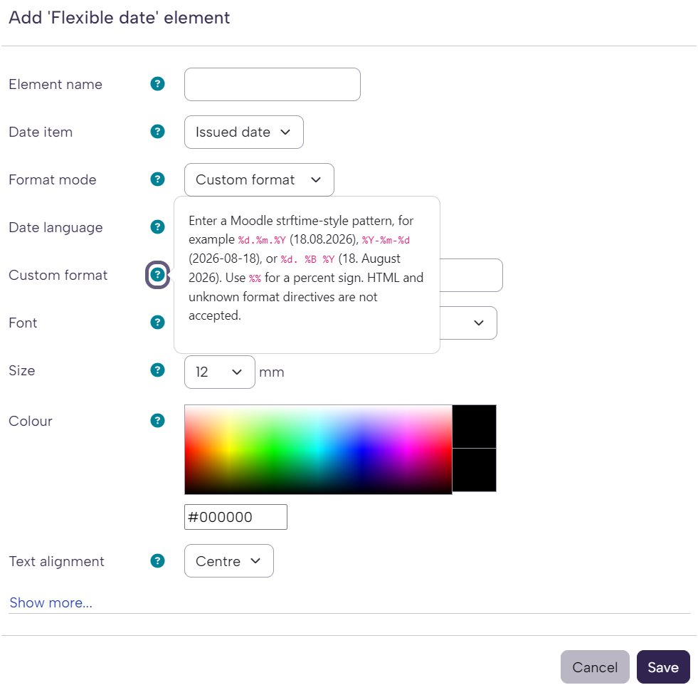

  

# Certificate Multitool - Cert. Element: Flexible Date

Display certificate issue or expiry dates in the format you need. Flex Date for tool_certificate
adds standard and custom date formats to Certificate manager, with an optional
language choice for each element.

## Certificate Multitool set

Use the text pair for course-managed wording and the image pair for course-specific pictures in a shared certificate template. Flexible Date supplies the date formatting. Choose the parts your workflow needs.

| Plugin | Role and companion |
| --- | --- |
| [Certificate Multitool – Course Field: Multiline Text](https://github.com/108design/moodle-customfield_multiline) | Stores course text, text mode and alignment. Pair it with Cert. Element for certificate output. |
| [Certificate Multitool – Cert. Element: Multiline Text](https://github.com/108design/moodle-certificateelement_coursefieldtext) | Renders that course text and supplies the course HTML preview. Requires Custom Field and Certificate manager. |
| [Certificate Multitool – Course Field: Image](https://github.com/108design/moodle-customfield_courseimage) | Provides a single-image course field. Pair it with Course field image for certificate output. |
| [Certificate Multitool – Cert. Element: Course Field Image](https://github.com/108design/moodle-certificateelement_coursefieldimg) | Places a course image on the certificate and preserves the issued image copy. Requires Certificate manager; it accepts Course image or a native textarea field with an internal image. |
| [Certificate Multitool - Cert. Element: Flexible Date](https://github.com/108design/moodle-certificateelement_flexdate) | Formats certificate issue and expiry dates. Requires Certificate manager. |

**Text pair:** install Custom Field and Cert. Element together for the course-text certificate workflow. **Image pair:** install Course image and Course field image together for the single-image upload workflow. The image element can also use a native textarea image without Course image. Course certificate is needed for course-based issuance and the text pair’s course HTML preview.

### Moodle 5.3 qualification

Moodle 5.3 integration is provisional: it has been tested with Certificate manager (tool_certificate) 5.0.10/5.0.11 outside those versions’ declared Moodle 5.0–5.2 support range. Check the compatibility of Certificate manager and, when used, Course certificate before deploying on Moodle 5.3. The course custom fields themselves do not require Certificate manager.

## Screenshot

## Features

- Display the certificate's issue date or expiry date.
- Choose a familiar Moodle date format or enter your own format for each element.
- Select an installed site language for month and weekday names, or use the
  certificate's language.
- Use Certificate manager's normal font, size, colour, alignment and positioning
  controls.

## Installation

1. Install a compatible **Certificate manager** (`tool_certificate`) release.
2. Install this plugin in `<moodle>/admin/tool/certificate/element/flexdate`.
   On Moodle installations with a split web directory, use
   `<moodle>/public/admin/tool/certificate/element/flexdate`.
3. Visit **Site administration → Notifications** to complete installation.
4. Open a certificate template and add **Flex Date**.
5. Select **Date item**, **Format mode** and, optionally, **Date language**.
6. Save the element and preview the certificate.

The directory name must remain `flexdate`. This is a Certificate manager element;
it does not require the Course certificate activity to edit a template.

## Compatibility

Requires Moodle 4.5 or later and a compatible Certificate manager installation.
The plugin targets Moodle 4.5–5.3 and supports issue and expiry dates. On Moodle 5.3, use a Certificate manager release suitable for that Moodle version. Flex Date has been tested with Certificate manager 5.0.10 on Moodle 5.3; that parent release currently declares support only through Moodle 5.2, so this does not extend the parent's own support declaration.

## Date formats and language

Choose **Standard format** to use Moodle's predefined date formats. Choose
**Custom format** to enter a strftime-style pattern, rather than `tt.mm.yyyy`
notation. Common patterns:

| Output | Pattern |
| --- | --- |
| `18.08.2026` | `%d.%m.%Y` |
| `18.08.26` | `%d.%m.%y` |
| `2026-08-18` | `%Y-%m-%d` |
| `18. August 2026` | `%d. %B %Y` |

Use `%%` for a literal percent sign. Formats are limited to 100 characters;
empty custom formats, HTML, control characters and unknown percent directives
are rejected. Dates use Moodle's timezone handling.

**Date language** can select any installed site language for this element's date.
This is useful when a template needs fixed month or weekday names. Leave it at
**Use certificate language** to follow Certificate manager's language choice.
The selection does not change the language of other elements.

## Privacy

Flex Date for tool_certificate stores formatting settings in the certificate template. It does not
store personal data of its own or send data to an external service. Certificate
issues and recipient records are managed by Certificate manager.

## Origin and attribution

This plugin was adapted in 2026 from the `certificateelement_date` implementation
in [`tool_certificate` 4.5.7](https://github.com/moodleworkplace/moodle-tool_certificate/tree/v4.5.7/element/date).
The original element was authored by Mark Nelson; its test patterns include work
by Daniel Neis Araujo. The adaptation and subsequent changes are copyright 2026
Andreas Giesen.
Fork maintainer: Andreas Giesen <andreas@108design.com> (108design).

## License

**Available free of charge under the terms of the applicable license.**

GNU General Public License version 3 or later. See [LICENSE](LICENSE) for the
complete license text.

This program is distributed in the hope that it will be useful,
but WITHOUT ANY WARRANTY; without even the implied warranty of
MERCHANTABILITY or FITNESS FOR A PARTICULAR PURPOSE.  See the
GNU General Public License for more details.
